<a href="https://guptakaran0720.vercel.app"><picture><source media="(prefers-color-scheme: dark)" srcset="cards/hero-dark.svg"></picture></a>

<picture><source media="(prefers-color-scheme: dark)" srcset="cards/graph-dark.svg"></picture>

<picture><source media="(prefers-color-scheme: dark)" srcset="cards/activity-dark.svg"></picture>

<a href="https://github.com/guptakaran20?tab=repositories"><picture><source media="(prefers-color-scheme: dark)" srcset="cards/tile-build-dark.svg"></picture></a> <a href="https://guptakaran0720.vercel.app"><picture><source media="(prefers-color-scheme: dark)" srcset="cards/tile-ship-dark.svg"></picture></a> <a href="https://leetcode.com/u/guptakaran0720/"><picture><source media="(prefers-color-scheme: dark)" srcset="cards/tile-solve-dark.svg"></picture></a>

<a href="https://guptakaran0720.vercel.app">Portfolio</a> · <a href="https://linkedin.com/in/guptakaran0720">LinkedIn</a> · <a href="https://leetcode.com/u/guptakaran0720/">LeetCode</a> · <a href="https://guptakaran0720.vercel.app/resume.pdf">Resume</a> · <a href="mailto:guptakaran0720@gmail.com">Email</a>

## Selected work

<a href="https://github.com/guptakaran20/EventFlow"><picture><source media="(prefers-color-scheme: dark)" srcset="cards/repo-eventflow-dark.svg"></picture></a> <a href="https://github.com/guptakaran20/CodeBattle"><picture><source media="(prefers-color-scheme: dark)" srcset="cards/repo-codearena-dark.svg"></picture></a>

<a href="https://github.com/guptakaran20/ImportlyAI"><picture><source media="(prefers-color-scheme: dark)" srcset="cards/repo-importlyai-dark.svg"></picture></a> <a href="https://github.com/guptakaran20/Sponsorship"><picture><source media="(prefers-color-scheme: dark)" srcset="cards/repo-sponsorgrid-dark.svg"></picture></a>

Live: <a href="https://goeventflow.vercel.app">EventFlow</a> · <a href="https://codearenabattle.vercel.app">CodeArena</a> · <a href="https://importlyai.vercel.app">ImportlyAI</a> · <a href="https://trysponsorgrid.vercel.app">SponsorGrid</a>

## Now — Full Stack Developer & App Lead, XCEED NIT Jalandhar

`233 PRs` `219 merged` `740+ commits` · App Lead *Aug 2026 – present* · intern *Jun – Jul 2026*

B.Tech Instrumentation & Control Engineering, NIT Jalandhar (2025 – 2029) · CGPA 8.49

- **ILEED** (formerly iAMS) — face-recognition attendance for **1,000+ students** across **30+ cameras**: FAISS, RetinaFace + AdaFace on ONNX Runtime, live RTSP streams
- **XCEED Learning App** — live on **Google Play** and the **App Store**; delta OTA updates (a 3-file release: **21.6 MB → 0.41 MB**), push, SOS alerts, 100+ automated web → app syncs
- **Performance** — fixed the bottlenecks behind **11.9s** responses and an **11.3%** timeout rate, an unbounded stream memory leak (heap at 91%), and cut ERP list loads **2.0s → 915ms**
- **Reliability** — IPC-routed worker pool (killing one drops **0 of 60** requests), one-click deploys with automatic rollback, GPU inventory dashboard

<b>Everything I shipped at XCEED</b>

#### 🎯 ILEED (formerly iAMS) – Intelligent Learning Engagement and Entity Detection

AI attendance platform for **1,000+ students** across **30+ cameras**

`219 PRs` `205 merged` `Jun – Oct 2026`

`Node.js` `Express` `React` `Python` `MongoDB` `FAISS` `ONNX Runtime` `FFmpeg` `FCM` `PM2` `Claude API` `Gemini API`

**📊 Results:** ERP list load **2.0s → 915ms** · **29 students** recovered from face-cluster merges · **0 of 60** requests dropped when a worker is killed

**🧠 Face recognition & ML pipeline**
- Built real-time, institute-wide student identification from uploaded videos and **live RTSP streams** on a **FAISS** vector index: **RetinaFace** detection, **AdaFace IR-50** embeddings and **MiniFASNetV2** anti-spoofing on **ONNX Runtime**
- **Per-frame voting after DBSCAN clustering**, recovering 29 students across 9 periods who were marked absent when neighbouring faces merged
- Active learning that keeps only clear face crops (sharpness, head pose, detector score, runner-up margin), with automated ERP embeddings and **nightly FAISS rebuilds**
- **AI Studio:** notes and quizzes from lecture transcripts and PDF/PPTX slides (up to 600 pages) with **Claude** and **Gemini**, reserving each call's worst-case cost so credit limits hold
- Added unknown-face storage and automated face clustering with confidence scores; integrated **Gemini** as the primary AI generation provider

**📸 Ground truth & attendance workflows**
- ERP photo upload and roster sync from the student database, plus a split-screen ground-truth editor with side-by-side ERP reference photos for double verification
- Ground-truth acquisition limited to college hours, forenoon/afternoon room acquisition, and **slot-wise attendance control**
- Attendance push and in-app notifications, delivered only to enrolled students

**🎥 Streaming & recording**
- Migrated the RTSP recording architecture to the Node.js backend: scheduled recordings, downloads and MP3 audio extraction
- Live-preview auto-retry and stale-frame detection; fixed a use-after-free when an RTSP capture was released before its reader thread stopped

**🛠️ Reliability, DevOps & observability**
- Split the Node.js server into an **IPC-routed pool** of quiz and learning workers that replaces frozen processes on its own
- One-click **Pull & Deploy** with a health check and **automatic rollback**; an ML-service deploy button that replaced manual `scp`
- **GPU inventory dashboard** with best-card selection, MIG-slice and per-service VRAM telemetry; fixed an H100 crash-loop
- Health monitoring, recovery/lifecycle email alerts, a twice-daily uptime digest, an SMTP-lockout-safe mail outbox, and a server error console
- Fixed an unbounded stream memory leak (heap at 91%), moved ML/data routes to non-blocking I/O, repaired the client & server test suites, and added one-click MongoDB backups

**🔐 Security**
- Fixed broken access control for the student role, a pre-quiz data leak, unauthenticated exposure of ERP roll numbers, and Host-header trust in OTA download URLs

#### 📱 XCEED Learning App — Android & iOS &nbsp;·&nbsp; *App Lead*

The AMS web platform as a native mobile app, live on Google Play: kept in sync with the web codebase and updated over the air.

`14 PRs` `420 commits` `Aug – Oct 2026`

`React` `Vite` `Capacitor` `Capgo Updater` `FCM` `TanStack Query` `GitHub Actions`

- **Built the app from the first commit:** PIN + native biometric sign-in, camera capture, multi-account switching, and deep links (Android App Links, iOS universal links)
- **OTA update pipeline:** a secure OTA server with GitHub Action deploys and an admin "Publish OTA" button, then **delta OTA** that downloads only the files a release changed: **0.41 MB** for a small release instead of a ~21.6 MB, 574-file zip every time
- **AMS → app sync pipeline:** 100+ automated syncs of the web client through a vendor branch, with custom merge drivers and automatic resolution of additive conflicts. Mobile-only behaviour lives behind override "seams" so the app never edits AMS files, and an `ams-edits` checker enforces it (sped up from 87s to 0.3s)
- **SOS alerts** that notify every admin and share the sender's live location every 30s, even with the app closed
- **Push notifications** via **Firebase Cloud Messaging**: attendance and quiz alerts, broadcasts to every app user, many-to-many device-token registration
- **Offline-first caching:** TanStack Query persisted to Capacitor Preferences and bounded by build version; a global 401 interceptor that ends zombie sessions
- Native file handling (timetable PDFs, study material and CSV exports saved in-app), leaner OTA and APK bundles, and keeping session tokens out of stream URLs
- **Launched iOS on the App Store**: CocoaPods, Universal Links, a light/dark launch screen and app icon

🔒 Private organisation repositories — stats are from the PRs and commits I authored.

## Open source

| Repository | Pull Requests | What I contributed |
|---|---|---|
| [**AarogyaClubNITJ/aarogya**](https://github.com/AarogyaClubNITJ/aarogya/pulls?q=is%3Apr+author%3Aguptakaran20) | **9 merged** · Aug 2026 | [#1](https://github.com/AarogyaClubNITJ/aarogya/pull/1) Real-time orientation quiz module — WebSocket-driven display screen with a QR code that rotates every 2s, token pool, live top-10 leaderboard, anti-cheat tab-switch detection, JWT admin login [#2](https://github.com/AarogyaClubNITJ/aarogya/pull/2) Explicit CORS allowlist for Express + Socket.IO and IP rate limiting behind Render's proxy [#15](https://github.com/AarogyaClubNITJ/aarogya/pull/15) 3-lifeline quiz system, with a submit lock that fixes a double-click race condition #3, #12, #13, #16, #17, #18 — API config, UI & question bank, CORS fix, token TTL, leaderboard sound, phone field |
| [**Abhishek-Verma0/Employee-Leave-Management-System**](https://github.com/Abhishek-Verma0/Employee-Leave-Management-System/pull/65) | **1 merged** · GSSoC'26 `level:advanced` | [#65](https://github.com/Abhishek-Verma0/Employee-Leave-Management-System/pull/65) Hardened auth validation (email normalization), ObjectId guards that return `400` instead of crashing with `500`, reimbursement amount validation, richer dashboard `populate`, and a standard `success` API contract |

## More projects

| Project | What it is | Stack |
|---|---|---|
| 🛒 [**Arovia Vibes**](https://github.com/guptakaran20/AroviaVibes) · [Live](https://aroviavibes.vercel.app) | Production eCommerce store with an admin panel, analytics and email workflows | `Next.js` `Supabase` `Resend` |
| 🎭 [**SeatSphere**](https://github.com/guptakaran20/SeatSphere) | Auditorium booking & event management: club event requests, admin approvals, seat locking & booking, QR ticket validation, OTP auth, 3D hero UI | `Next.js` `Prisma` `NextAuth` |
| 🌐 [**Portfolio**](https://github.com/guptakaran20/portfolio) · [Live](https://guptakaran0720.vercel.app) | A wall of doors you walk through: a pull-cord light switch drawn on canvas, a flip-calendar hero, and project rooms showing the live sites · 79 commits | `Next.js` `TypeScript` `Canvas` |

## Stack

Also: Socket.IO · gRPC · Redis Streams · FAISS · ONNX Runtime · FFmpeg · Prisma · SQLAlchemy · Capacitor · Prometheus · Grafana · Gemini & Claude APIs

---

Cards are animated SVGs drawn by <a href="scripts/render_cards.py"><code>scripts/render_cards.py</code></a> and refreshed daily by a GitHub Action. Eat · Code · Sleep · Repeat.

